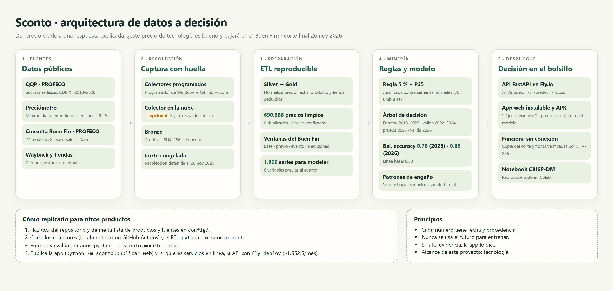

# Arquitectura de Sconto y cómo replicarla



Sconto convierte precios públicos en una respuesta explicada: **¿este precio es bueno y bajará en el Buen Fin?** Este proyecto se limita a tecnología. Las mismas piezas sirven para otros productos, siempre que existan fuentes de precios equivalentes.

## Piezas

| Etapa | Qué hace | Código |
|---|---|---|
| Fuentes | QQP de PROFECO (sucursales físicas, 2018–2026), Preciómetro (mínimo en línea, 2026), consulta del Buen Fin de PROFECO (2026) | `src/sconto/fuentes/` |
| Recolección | Colectores programados (Windows y GitHub Actions) y colector opcional en Fly. Cada crudo se guarda con su SHA-256 | `src/sconto/run_diario.py`, `src/sconto/colector_nube_v2.py` |
| Preparación | Bronze → silver → gold, deduplicación por clave, ventanas del Buen Fin y series comparables | `src/sconto/dataset.py`, `src/sconto/v2_history.py` |
| Minería | Reglas justificadas contra semanas normales, modelo evaluado por años y análisis de patrones de precio | `src/sconto/modelo_final.py`, `src/sconto/conclusiones.py` |
| Despliegue | API FastAPI con el modelo exportado a JSON y app web instalable (PWA) con APK | `src/sconto/api_v2.py`, `src/sconto/api_modelo.py`, `web/`, `android/` |

## Levantar tu propio Sconto

Requisitos: Python 3.11, Node 22 (sólo para pruebas y capturas), cuenta de GitHub y, si quieres la API en línea, cuenta de Fly.io.

1. **Copia el proyecto y define qué vigilar.**

   ```powershell
   git clone https://github.com/d1512pb/sconto-reale-o-falso.git
   cd sconto-reale-o-falso
   python -m venv .venv
   .\.venv\Scripts\pip install -r requirements.txt -e .
   ```

   La lista de productos y fuentes está en `config/`. El catálogo de tecnología es `config/preciometro_diarios.csv` y las ventanas del evento están en `config/eventos.yaml`.

2. **Recolecta y limpia.**

   - `python -m sconto.run_diario` hace una ronda de recolección.
   - `python -m sconto.operacion --solo-preparar` construye el gold.
   - En GitHub Actions, el workflow `recoleccion_diaria.yml` hace lo mismo cada día y publica el paquete en un release.

3. **Entrena y evalúa sin mirar el futuro.**

   ```powershell
   python -m sconto.modelo_final --paquete sconto_colab_AAAA-MM-DD.zip --salida reports/modelo_final --modelos modelos
   python -m sconto.conclusiones --paquete sconto_colab_AAAA-MM-DD.zip --salida reports/conclusiones
   ```

   El primer comando elige el modelo con validación por años y prueba con el año más reciente. El segundo mide rebajas reales, rebajas aparentes y precios señuelo.

4. **Publica la app.**

   ```powershell
   python -m sconto.mart --paquete sconto_colab_AAAA-MM-DD.zip --salida app/analitica
   python -m sconto.app_modelo --modelo modelos/modelo_final.joblib --salida app/modelo
   python -m sconto.publicar_web --datos app/analitica --salida app/sitio --recursos web --api / --modelo app/modelo/modelo.json
   ```

   El sitio funciona sin conexión y puede servirse desde GitHub Pages o junto a la API.

5. **(Opcional) API en línea.** `fly deploy --ha=false` crea una máquina de 256 MB con volumen cifrado, por unos US$2.5 al mes. Expone:

   - `GET /v1/modelo`: tarjeta del modelo y métricas.
   - `GET /v1/products/{id}/prediccion`: predicción y resultado observado.
   - `GET /v1/products/{id}/evaluar-precio?precio=`: el precio frente a la historia del producto.
   - `POST /v1/predecir`: recibe el historial de cualquier producto y responde si bajará en el Buen Fin, con la explicación del árbol.
   - `/docs`: documentación interactiva.

   La máquina tiene un corte preventivo de gasto: se apaga al llegar a 5 GB de salida en el mes.

## Decisiones de diseño

- **El servidor no necesita scikit-learn.** El árbol se exporta a JSON y se evalúa con Python puro; `tests/test_modelo_final.py` comprueba que da las mismas probabilidades.
- **Los umbrales se justifican con datos.** La regla de 5 % con el cuartil P25 se eligió comparando 30 umbrales contra semanas normales.
- **El tiempo manda.** El modelo se entrena con ediciones pasadas, se elige con validación por años y se prueba con un año que no participó en ninguna decisión.
- **La evidencia se puede rastrear.** Cada corte tiene manifiesto SHA-256 y la app verifica las huellas antes de mostrar datos.
